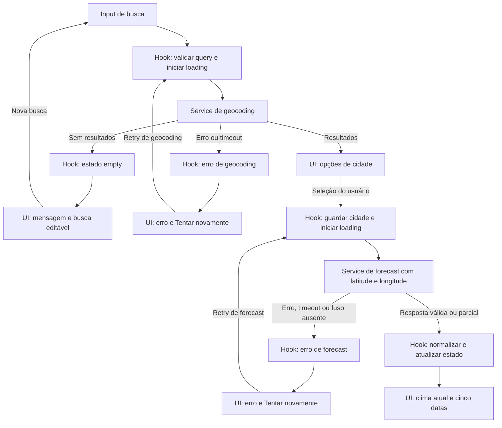

# Plano Técnico — Weather App

Fonte da verdade: [`specs/weather-app-spec.md`](../specs/weather-app-spec.md). Este documento define arquitetura e contratos; não contém implementação final.

## Architecture

Aplicação React client-side em camadas, sem backend, autenticação ou persistência. Dependências seguem uma direção: `components` → `hooks` → `services` → APIs externas; `lib` contém funções puras reutilizadas pelas camadas, sem importar React, acessar rede ou alterar estado global.

- **`components` — apresentação:** renderizam props, estados acessíveis e controles; emitem callbacks. Não fazem `fetch`, coordenam requisições nem implementam regras de domínio.
- **`hooks` — orquestração e estado:** coordenam busca, seleção, consulta, retry, unidade, concorrência e cancelamento. Chamam contratos de `services` e expõem estado/ações prontos para a UI.
- **`services` — acesso a dados:** constroem URLs, chamam `fetch`, aplicam timeout, validam status e payload externo e delegam normalização a `lib`. Não mantêm estado da tela.
- **`lib` — funções puras:** convertem payloads para modelos de domínio, traduzem códigos WMO, calculam idade dos dados, convertem unidades e formatam datas. Entradas iguais produzem saídas iguais, sem I/O.
- **`app` — composição:** monta o hook e os componentes da tela; sem regras de negócio.

Essa divisão permite testar regras de `lib` sem DOM ou mocks, serviços com `fetch` controlado, hooks com serviços simulados e componentes com props previsíveis. Testes de integração cobrem o contrato entre camadas.

## Tech Stack

- TypeScript strict, React 19 e Vite, conforme `package.json`.
- Tailwind CSS para apresentação responsiva.
- `fetch` nativo; sem cliente HTTP, cache global ou biblioteca de estado adicional.
- Vitest e Testing Library para testes unitários/de integração; Playwright para E2E.
- Biome para lint e formatação.
- Não adicionar dependências ao MVP sem necessidade demonstrada.

## Project Structure

```text
src/
  app/
    App.tsx
  components/
    CitySearchForm.tsx
    LocationResults.tsx
    CurrentWeather.tsx
    ForecastList.tsx
    TemperatureUnitToggle.tsx
    RequestStatus.tsx
  hooks/
    useWeatherApp.ts
  services/
    openMeteoClient.ts
  lib/
    openMeteoMapper.ts
    temperature.ts
    weatherCode.ts
    localDate.ts
  types/
    weather.ts
  main.tsx
tests/
  unit/
    lib/
    services/
  integration/
  e2e/
```

Manter componentes pequenos e separados por responsabilidade. `openMeteoClient.ts` é a única camada que conhece URLs e o formato bruto das APIs; `openMeteoMapper.ts` é puro e traduz esses formatos para os tipos em `types/weather.ts`. Não criar um diretório adicional para cada componente ou função.

## Data Model

Tipos de domínio independentes dos nomes de campos da API:

```ts
type TemperatureUnit = "celsius" | "fahrenheit";

interface CityLocation {
  id: string;
  name: string;
  admin1?: string;
  country?: string;
  latitude: number;
  longitude: number;
}

interface CurrentConditions {
  temperatureC: number | null;
  weatherCode: number | null;
  referenceTimeEpochSeconds: number | null;
}

interface ForecastDay {
  localDate: string; // YYYY-MM-DD na cidade
  weatherCode: number | null;
  minimumC: number | null;
  maximumC: number | null;
}

interface WeatherSnapshot {
  location: CityLocation;
  timezone: string | null;
  current: CurrentConditions;
  forecast: ForecastDay[]; // normalizado para cinco datas quando houver fuso
  receivedAtEpochMs: number;
}
```

Invariantes:
- Temperaturas persistem no estado apenas em Celsius; Fahrenheit é derivado na apresentação.
- `CityLocation.id` usa o ID do provedor quando disponível; fallback estável: coordenadas e nome normalizados. A UI ainda exibe latitude/longitude a quatro casas quando os metadados não desambiguam resultados.
- `forecast` tem cinco itens quando há fuso. Campos/dias ausentes viram `null`, sem estimativa. Sem fuso, a consulta de previsão resulta no estado de erro definido na spec.
- A atualidade do clima atual é `fresh` somente com timestamp presente e idade entre 0 e 3 horas; timestamp futuro, ausente ou mais antigo é `unverifiable`/`stale` e nunca é rotulado como atual.

## Data Flow

1. Submissão da busca: remover espaços externos; se vazia, não chamar a API. Preservar caracteres internos e enviar como parâmetro codificado.
2. Geocodificação: mostrar loading, buscar opções e normalizar metadados. Lista ausente ou vazia vira estado `empty`; falha mantém consulta editável e retry.
3. Seleção: guardar a localização selecionada e consultar previsão usando exatamente latitude/longitude dela.
4. Consulta meteorológica: obter clima atual e cinco datas em uma requisição; decodificar e validar campos, timezone e timestamp.
5. Normalização: converter dados externos para `WeatherSnapshot`; completar posições ausentes das cinco datas com valores nulos, nunca com dados inferidos.
6. Apresentação: formatar datas no timezone da cidade; apresentar campos indisponíveis separadamente; converter temperatura conforme unidade selecionada.
7. Troca de cidade: abortar requisições anteriores quando possível e sempre descartar respostas cujo identificador de requisição/seleção não seja o atual.



## External APIs

As duas APIs são chamadas diretamente do navegador, sem API key. O cliente aplica timeout de 15 segundos, valida HTTP/JSON e normaliza os payloads para os tipos de domínio abaixo; a UI não recebe a resposta bruta.

### Geocoding — Open-Meteo

**URL:** `https://geocoding-api.open-meteo.com/v1/search`

**Parâmetros:** `name` é o nome da cidade após remover espaços externos; `count=10` limita opções; `language=pt` solicita nomes em português; `format=json` define o formato. Montar a query com `URLSearchParams`.

**Resposta resumida:**

```json
{
  "results": [
    {
      "id": 1234567,
      "name": "São Paulo",
      "latitude": -23.55,
      "longitude": -46.63,
      "admin1": "São Paulo",
      "country": "Brazil"
    }
  ]
}
```

**Mapeamento para `CityLocation`:** `id` vira string; se ausente, gerar chave estável com nome normalizado e coordenadas. `name`, `admin1`, `country`, `latitude` e `longitude` são mapeados diretamente; `admin1` e `country` ausentes viram `undefined`. `results` ausente, `null` ou vazio normaliza para lista vazia (`AC-01.5`).

### Forecast — Open-Meteo

**URL:** `https://api.open-meteo.com/v1/forecast`

**Parâmetros:** `latitude` e `longitude` vêm da cidade selecionada; `current=temperature_2m,weather_code`; `daily=weather_code,temperature_2m_min,temperature_2m_max`; `forecast_days=5`; `timezone=auto`; `temperature_unit=celsius`; `timeformat=unixtime`.

**Resposta resumida:**

```json
{
  "timezone": "America/Sao_Paulo",
  "utc_offset_seconds": -10800,
  "current_units": {
    "time": "unixtime",
    "temperature_2m": "°C",
    "weather_code": "wmo code"
  },
  "current": {
    "time": 1793286000,
    "temperature_2m": 21.4,
    "weather_code": 2
  },
  "daily_units": {
    "time": "unixtime",
    "weather_code": "wmo code",
    "temperature_2m_min": "°C",
    "temperature_2m_max": "°C"
  },
  "daily": {
    "time": [1793242800, 1793329200, 1793415600, 1793502000, 1793588400],
    "weather_code": [2, 3, 61, 1, 0],
    "temperature_2m_min": [17.5, 18.0, 17.2, 16.8, 17.1],
    "temperature_2m_max": [24.8, 25.1, 22.0, 26.0, 27.2]
  }
}
```

**Mapeamento para o modelo de domínio:**
- `timezone` vai para `WeatherSnapshot.timezone`; `receivedAtEpochMs` é o instante local de recebimento (`Date.now()`), não um campo da API.
- `current.temperature_2m` vai para `CurrentConditions.temperatureC`; `current.weather_code` para `weatherCode`; `current.time` para `referenceTimeEpochSeconds`. Validar atualidade usando esse timestamp Unix e o limite de três horas da spec.
- Para cada índice `i` de 0 a 4, juntar as posições de `daily.time[i]`, `weather_code[i]`, `temperature_2m_min[i]` e `temperature_2m_max[i]` em um `ForecastDay`: `localDate` é a data civil formatada no `timezone`; `weatherCode`, `minimumC` e `maximumC` recebem os respectivos valores.
- Converter campos numéricos ausentes ou arrays curtos em `null`, mantendo cinco datas e sem estimar valores (`AC-02.4`, `AC-03.3`). `weather_code` permanece numérico; a tradução pt-BR usa o mapeamento WMO de `AC-02.3`.
- Não usar `utc_offset_seconds` como timezone permanente: datas devem ser formatadas com o identificador IANA retornado em `timezone`, que contempla mudanças de horário.

## State Management

Um único `useReducer` no hook `useWeatherApp` mantém estado efêmero da tela; evitar estado duplicado em componentes e não usar `localStorage`.

```ts
type RequestStatus = "idle" | "loading" | "success" | "empty" | "error";

type AppState = {
  query: string;
  locations: CityLocation[];
  selectedLocation: CityLocation | null;
  unit: TemperatureUnit;
  searchStatus: RequestStatus;
  weatherStatus: RequestStatus;
  snapshot: WeatherSnapshot | null;
  error: WeatherError | null;
};
```

O estado inicial usa Celsius. Busca e clima têm status independentes para preservar a consulta e permitir mensagens precisas. Cada operação recebe um request ID; só a operação corrente pode atualizar o reducer. `AbortController` cancela trabalho dispensável, mas o request ID continua sendo a proteção contra respostas tardias.

## Error Handling

Contrato de erro para UI, sem propagar exceções ou payloads do provedor:

```ts
type WeatherErrorCode =
  | "network"
  | "timeout"
  | "rate-limit"
  | "provider"
  | "invalid-response"
  | "timezone-unavailable"
  | "stale-data";

interface WeatherError {
  code: WeatherErrorCode;
  operation: "geocoding" | "forecast";
  retryable: boolean;
}
```

- Busca sem correspondências é `empty`, não erro.
- Rede, HTTP 5xx/429 e timeout são recuperáveis; retry repete a mesma operação e mantém query ou cidade.
- Timeout após 15 s aborta a requisição. Cancelamento causado por nova ação não mostra mensagem de erro.
- Resposta inválida é erro recuperável; campos ausentes em resposta válida são estado parcial, com placeholder por campo.
- Dados atuais vencidos/sem timestamp são identificados como desatualizados ou não verificáveis, com retry; previsão válida permanece visível.
- Falha de nova consulta não permite mostrar dados da cidade anterior como atuais.
- Mensagens e estados acessíveis são em pt-BR; loading e erros são anunciados por status sem mover foco indevidamente.

## Testing Strategy

### Vitest

- **Funções puras em `lib`:** converter °C↔°F sem request; testar negativos, limites e arredondamento (incluindo empate afastado de zero); mapear todos os códigos WMO e código desconhecido; validar atualidade no limite de três horas, timestamp ausente/futuro; formatar datas em timezone IANA e validar o mapeamento de arrays incompletos para `null`.
- **Services com `fetch` mockado:** conferir URLs, parâmetros e coordenadas exatos; respostas de sucesso, `results` vazio/ausente, JSON inválido, rede, timeout, HTTP 429/5xx e arrays de forecast curtos. Verificar que payloads válidos são encaminhados ao mapper e erros são normalizados sem expor o corpo bruto à UI.
- **Hooks e integração:** selecionar cidade consulta as coordenadas correspondentes; loading e retry mantêm query/cidade; resposta antiga não substitui a seleção atual; alternância de unidade atualiza todos os valores sem nova chamada.
- **Componentes com Testing Library e `user-event`:** testar estados `loading`, `error`, `empty` e `success` de busca/resultados e clima/previsão; ações de submit, seleção, retry e unidade; nomes acessíveis e anúncio de status. Injetar dados e callbacks, sem rede real.

### Playwright

- **Fluxo E2E principal:** digitar cidade, selecionar resultado, exibir clima e exatamente cinco datas, alternar °C/°F e confirmar que a troca não emite outra chamada meteorológica.
- **Fluxos de borda:** busca sem resultados; erro de rede seguido de retry; timeout; consulta parcial com campos indisponíveis; selecionar outra cidade enquanto uma resposta anterior está pendente.
- Interceptar geocoding e forecast com fixtures para que os testes sejam determinísticos e independentes da disponibilidade externa. Manter, se necessário, um smoke test separado para confirmar conectividade real com o provedor.
- **Viewports:** percorrer o fluxo principal em 320 px (mobile), 768 px (tablet) e 1440 px (desktop); verificar ausência de rolagem horizontal, conteúdo cortado e controles inacessíveis. Cobrir os alvos de navegador definidos em NFR-07.
- A validação manual de teclado/leitores de tela e a medição operacional (100 execuções para p95 e verificações sintéticas a cada cinco minutos para disponibilidade) complementam os testes automatizados; não são substituídas por E2E.

## Risks & Trade-offs

- **Chamadas diretas do navegador:** mantém o MVP sem backend e aproveita a API sem chave, mas disponibilidade e latência do provedor afetam diretamente a experiência. Alternativa: proxy/backend próprio, que permite cache e maior controle, mas adiciona infraestrutura e operação; não adotado no MVP.
- **`useReducer` local versus biblioteca global:** reducer/hook é suficiente para uma tela e evita dependência adicional. Zustand/Redux só se justificariam com múltiplas áreas que compartilham estado complexo; acrescentariam configuração e conceitos sem benefício atual.
- **`fetch` nativo versus cliente HTTP:** `fetch` reduz dependências e atende os dois endpoints. Axios ou outro cliente pode simplificar interceptors/retry globais, mas não é necessário para esse escopo; timeout e normalização ficam em `services`.
- **Celsius como fonte versus duas unidades no estado/API:** guardar valores originais em Celsius e converter durante a renderização evita request ao alternar, mantém uma única fonte de verdade e simplifica testes. Buscar ambas as unidades ou armazenar valores duplicados adicionaria chamadas/estado sujeito a divergência.
- **Sem cache persistente:** segue a restrição de não persistir dados e evita exibir forecast antigo, mas consultas repetidas podem aumentar latência e chamadas. Cache local poderia melhorar velocidade, porém exigiria política de expiração e apresentação explícita de idade; não adotado.
- **Limite rígido de atualidade (3 h):** impede rotular dado antigo como atual, mas pode ocultar temperatura em falhas prolongadas. Exibir o último valor com aviso seria alternativa, porém a spec exige não apresentá-lo como atual; a UI deve dizer “desatualizado” e preservar previsão válida.
- **Fixtures em E2E versus APIs reais:** fixtures tornam os testes reproduzíveis e rápidos; deixam a integração externa sem cobertura em cada execução. Um smoke test separado pode detectar mudanças no provedor sem tornar a suíte principal dependente da rede.
- **Fuso IANA versus offset fixo:** usar o timezone retornado lida com mudanças de horário; um offset fixo seria mais simples, mas pode deslocar datas em locais com horário de verão.
